# TLP-Desk

**Free, open-source remote desktop for your local network: offline, encrypted, and written in pure Rust.**

TLP-Desk lets one Windows PC see and control another PC on the same LAN. It has no cloud, no relay
server, no account and no telemetry, and it keeps working with the internet cable unplugged.
A single app is both the **host** (the PC being controlled) and the **viewer** (the PC in control).
The interface is available in **Arabic (right-to-left)** and **English**.

> Status: early development (`0.1.x`). The core remote-control experience works and the features
> below are being built in the open. See [ROADMAP.md](ROADMAP.md).

<p align="center">
  <picture>
    <source media="(prefers-color-scheme: dark)" srcset="docs/media/home-en-dark@2x.png">
    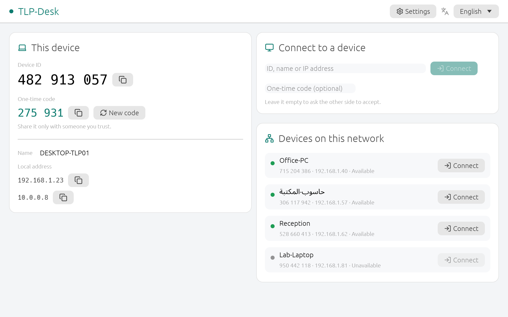
  </picture>
</p>

### See it in action

<p align="center">
  <a href="docs/media/demo-en.mp4">
    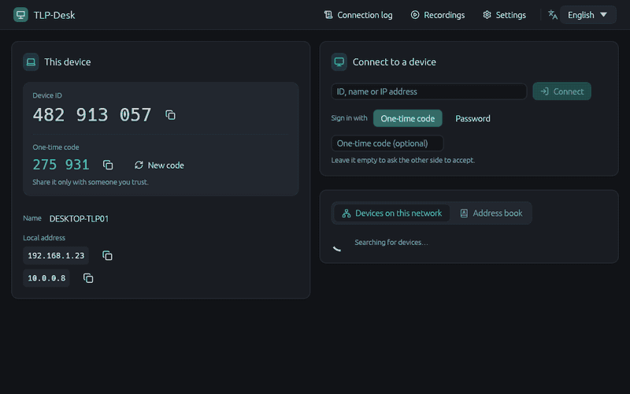
  </a>
  <br><sub>Connect by ID and one-time code, control the remote PC, switch screens, disconnect.
  <a href="docs/media/demo-en.mp4">Full-quality MP4</a> ·
  <a href="docs/media/demo-ar.mp4">Arabic version</a></sub>
</p>

**English and Arabic (right-to-left), side by side:**

<table>
  <tr>
    <td width="50%">
      <picture>
        <source media="(prefers-color-scheme: dark)" srcset="docs/media/session-en-dark.png">
        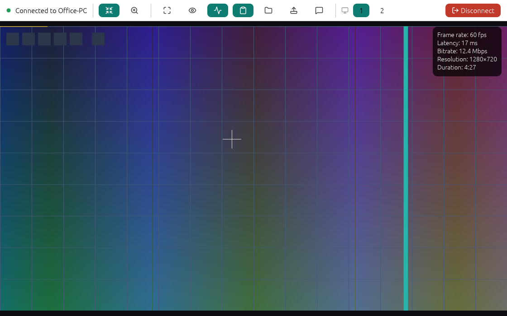
      </picture>
    </td>
    <td width="50%">
      <picture>
        <source media="(prefers-color-scheme: dark)" srcset="docs/media/session-ar-dark.png">
        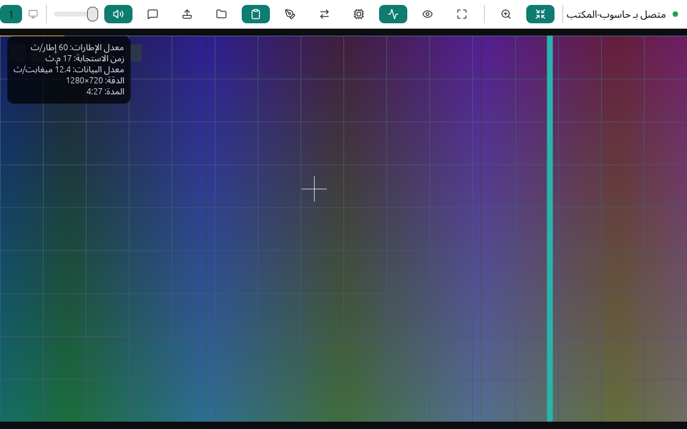
      </picture>
    </td>
  </tr>
</table>

<details>
<summary><b>More screenshots</b></summary>

| | |
|---|---|
| 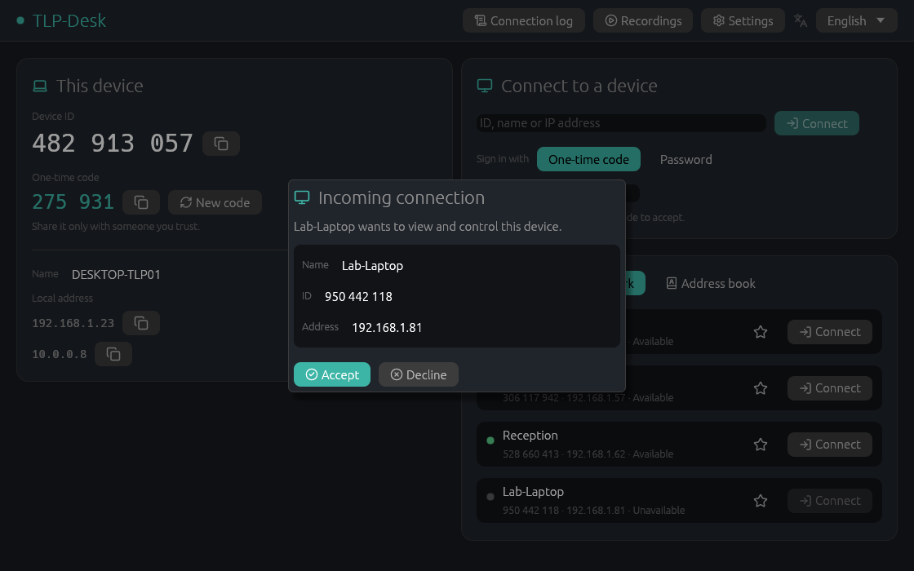 | 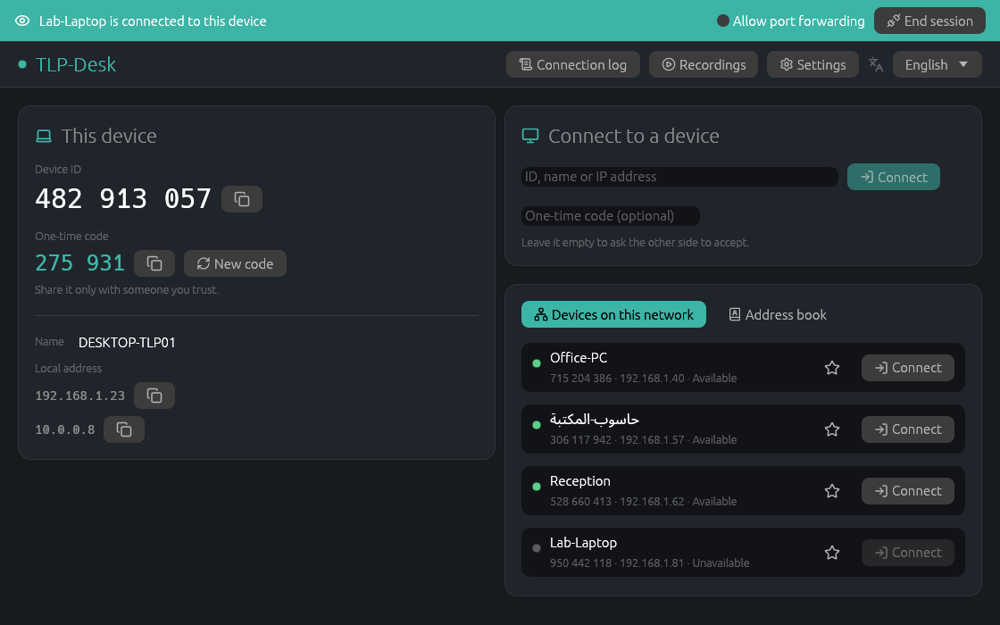 |
| **Accept prompt** on the host | **Always-visible banner**: who is connected |
| 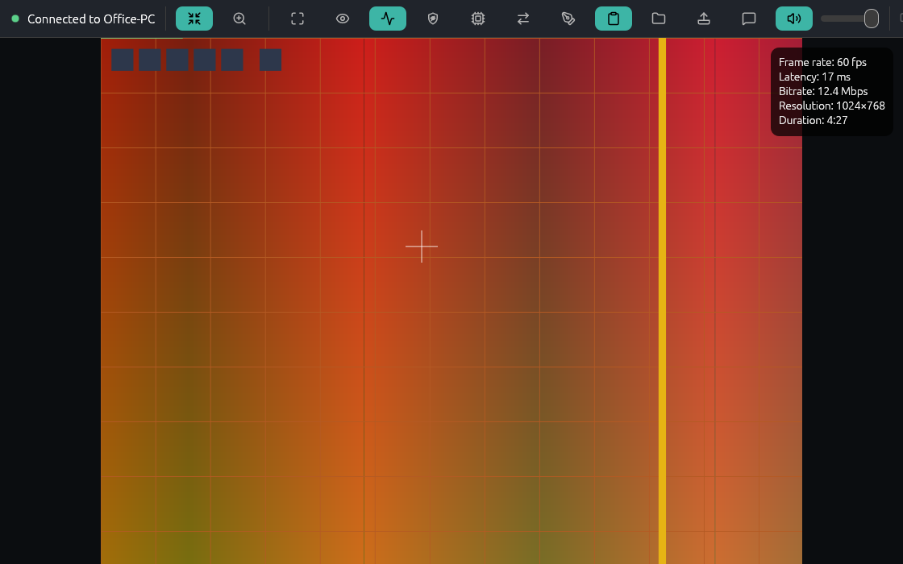 | 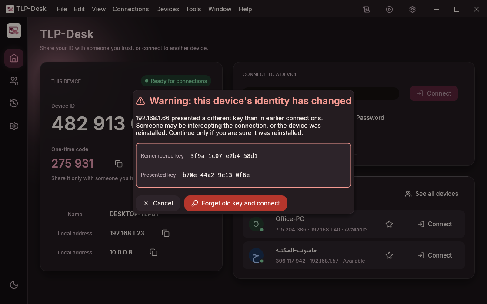 |
| **Switch between the host's screens** | **Loud warning** if a host's identity changes |
| 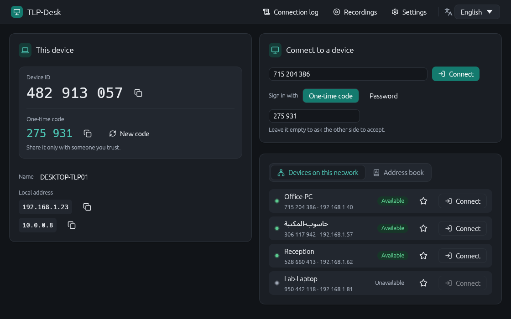 | 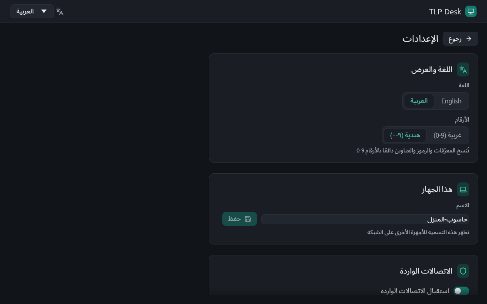 |
| **Connect** by ID, name or IP, with an optional code | **Settings**: language and digit style |

All images and videos are generated from the real UI by
[`scripts/update-readme-media.ps1`](scripts/update-readme-media.ps1); see
[docs/media](docs/media) for every screen in both languages and themes.

</details>

---

## Features

**Working today**

- **Find devices automatically** on the LAN (mDNS, with a UDP broadcast fallback), or connect by
  9-digit device ID, name or IP address.
- **Secure by default.** Every connection uses QUIC with TLS 1.3. Each install has its own key, and
  the 9-digit ID is derived from that key, so dialing an ID pins the host's identity.
  Trust-on-first-use with a loud warning applies when you connect by IP.
- **Two ways to allow a session:** the host user clicks *Accept*, or the viewer enters a one-time
  6-digit code (SPAKE2, so the code never crosses the network and it rotates after use).
  A permanent password for unattended access is coming with the Windows service.
- **LAN only.** By default only private (RFC 1918) and link-local addresses may connect. Login
  attempts are rate-limited, with a lockout after repeated failures.
- **Smooth video:** about 60 fps of H.264 video, captured with Windows.Graphics.Capture (DXGI
  fallback) and downscaled on the GPU. If the network falls behind, frames are dropped rather than
  queued, so lag doesn't build up.
- **Full control:** mouse, wheel and keyboard sent as hardware scancodes, so Arabic and English
  keyboard layouts both work. Win, Alt+Tab and Ctrl+Esc go to the remote PC while the session
  window has focus.
- **The person at the host always wins.** Touching the local mouse or keyboard pauses remote input,
  and a green marker shows where the remote pointer is.
- **Multi-monitor hosts:** switch between the host's screens live.
- **Arabic first-class:** properly joined letters, mixed Arabic/English in the right order, mirrored
  layouts, and a choice of Arabic-Indic or Western digits.
- **Single `setup.exe` installer** (Arabic + English) that adds Windows Firewall rules for private
  networks only, plus a portable zip.

**In progress** (tracked in the [roadmap](ROADMAP.md))

Very fast file transfer and a remote file browser, clipboard sync (text, images, files), chat,
system audio, unattended access as a Windows service (lock screen, UAC, Ctrl+Alt+Del), privacy mode,
address book, adaptive quality and hardware encoding, Wake-on-LAN, port
forwarding, connection log, device info, and a full CLI.

---

## Install

1. Download `TLP-Desk-<version>-setup.exe` from the
   [Releases](https://github.com/Tamer-Mansour/TLP-Desk/releases) page.
2. Run it. The installer isn't code-signed yet, so Windows SmartScreen may warn:
   choose **More info → Run anyway**.
3. Start **TLP-Desk** on both PCs. Make sure both are on the same network and that the network is
   set to **Private** in Windows.

**Portable:** unzip `TLP-Desk-<version>-win-x64-portable.zip` and run `TLP-Desk.exe`. Allow the
Windows Firewall prompt the first time.

**Requirements:** Windows 10 (2004 or newer) or Windows 11, x64.

**Current release:** `v1.0.0-rc.1` (release candidate). See the
[changelog](docs/src/changelog.md), the [system test report](docs/src/dev/system-test-report.md)
and the [two-PC manual test checklist](docs/src/user-guide/en/manual-test.md)
([بالعربية](docs/src/user-guide/ar/manual-test.md)).

### Network ports

| Port | Protocol | Purpose |
|---|---|---|
| 47400 | UDP | Sessions (QUIC / TLS 1.3) |
| 47401 | UDP | Discovery broadcast fallback |
| 5353 | UDP | mDNS discovery (`_tlpdesk._udp.local.`) |

---

## Quick start

1. On the PC you want to control, open TLP-Desk and note its **device ID** and **one-time code**.
2. On your PC, pick it from **Devices on this network**, or type its ID or IP address.
3. Either enter the one-time code, or leave the code empty and click **Accept** on the other PC.
4. Control it. Use the toolbar for fit / actual size, full screen, view-only, screen switching,
   the stats overlay, and disconnect.

---

## Documentation

The full documentation is an [mdBook](https://rust-lang.github.io/mdBook/) in [`docs/`](docs/)
(build it with `mdbook build docs`; it is published to GitHub Pages from `TLP-Desk`):

- **User guide:** [English](docs/src/user-guide/en/index.md) ·
  [العربية](docs/src/user-guide/ar/index.md) — installing, connecting, controlling, settings,
  troubleshooting, FAQ.
- **[Security model](docs/src/security.md)** — threat model, identity and pinning, known limitations.
- **Contributor guide:** [architecture](docs/src/dev/architecture/index.md),
  [one page per crate](docs/src/dev/crates/index.md), [building](docs/src/dev/building.md),
  [testing](docs/src/dev/testing.md), [i18n and Arabic](docs/src/dev/i18n.md),
  [release process](docs/src/dev/release.md).
- **[Architecture decision records](docs/src/adr/index.md)** and the
  [wire protocol](docs/protocol.md).

---

## Build from source

Prerequisites (Windows):

- [Rust](https://rustup.rs) stable (the version is pinned in `rust-toolchain.toml`)
- Visual Studio Build Tools with **Desktop development with C++** and the Windows 11 SDK
- [NASM](https://www.nasm.us) on `PATH` (optional, makes the H.264 encoder much faster)
- [Inno Setup 6](https://jrsoftware.org/isinfo.php) (only to build the installer)

```powershell
git clone https://github.com/Tamer-Mansour/TLP-Desk.git
cd TLP-Desk

# Optional: keep build output on a drive with plenty of space
$env:CARGO_TARGET_DIR = "C:\tlp-build\main"

cargo build --release            # TLP-Desk.exe and TLP-Desk-cli.exe
cargo run --release -p tlp-desk-app

# Full quality gate: format, release build, clippy -D warnings, tests
powershell -ExecutionPolicy Bypass -File scripts\check.ps1

# Installer and portable zip (written to dist\)
powershell -ExecutionPolicy Bypass -File installer\build-setup.ps1
powershell -ExecutionPolicy Bypass -File installer\portable.ps1
```

---

## Project layout

| Path | What lives there |
|---|---|
| `crates/tlp-desk-proto` | Wire messages, `PROTOCOL_VERSION`, framing |
| `crates/tlp-desk-crypto` | Identity keys, device ID, pinning, SPAKE2, rate limiting |
| `crates/tlp-desk-net` | QUIC transport, discovery, Wake-on-LAN |
| `crates/tlp-desk-capture` | Screen capture (Windows.Graphics.Capture / DXGI) |
| `crates/tlp-desk-codec` | Video encode/decode (H.264 via OpenH264) |
| `crates/tlp-desk-input` | Input injection, keyboard capture, local-priority hooks |
| `crates/tlp-desk-host` / `tlp-desk-viewer` | Session logic for each side |
| `crates/tlp-desk-app` | The GUI (egui / wgpu), Arabic + English |
| `crates/tlp-desk-cli` | Headless CLI for scripts and testing |
| `installer/` | Inno Setup installer and portable packaging |
| `docs/` | Protocol, code style, user and developer guides |

More detail: [docs/protocol.md](docs/protocol.md) · [docs/CODE_STYLE.md](docs/CODE_STYLE.md)

---

## Contributing

Contributions are welcome. In short:

- Branch from `TLP-Desk` as `TLP-<topic>` and open a pull request back into `TLP-Desk`.
- Commit messages follow `TLP-<area>: what changed`.
- Every PR must pass `cargo fmt`, `cargo clippy -- -D warnings` and `cargo test --workspace`.
- **Clean-room rule:** never copy code, protocol details, assets or UI text from other remote
  desktop products.
- Any feature that shows or moves text must work in Arabic.
- Changed something visible? Run `scripts\update-readme-media.ps1` and commit the updated
  `docs/media/` in the same PR. Other screenshots never go into git.

Start with [CONTRIBUTING.md](CONTRIBUTING.md). The full rules for humans and coding agents are in
[CLAUDE.md](CLAUDE.md) and
[docs/CODE_STYLE.md](docs/CODE_STYLE.md).

---

## Security

TLP-Desk is designed for trusted local networks. Please report vulnerabilities privately through
GitHub Security Advisories rather than public issues; see [SECURITY.md](SECURITY.md).

---

## نبذة بالعربية

<div dir="rtl">

**TLP-Desk** برنامج مجاني ومفتوح المصدر للتحكم بجهاز آخر عن بُعد داخل الشبكة المحلية فقط، بدون
إنترنت ولا خوادم ولا حسابات. البرنامج نفسه يعمل كجهاز مُتحكَّم به وكجهاز متحكِّم، وواجهته متوفرة
بالعربية (من اليمين لليسار) وبالإنجليزية.

<p align="center">
  <picture>
    <source media="(prefers-color-scheme: dark)" srcset="docs/media/home-ar-dark@2x.png">
    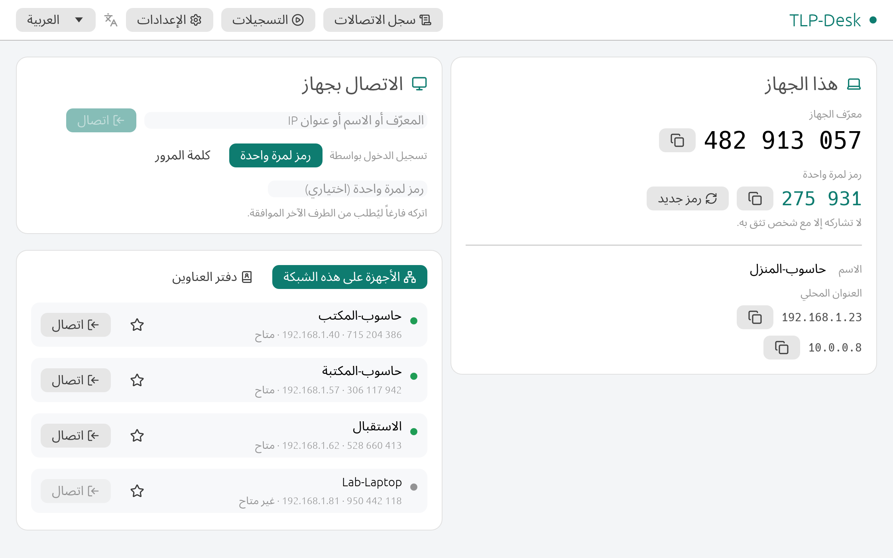
  </picture>
</p>

<p align="center">
  <a href="docs/media/demo-ar.mp4">
    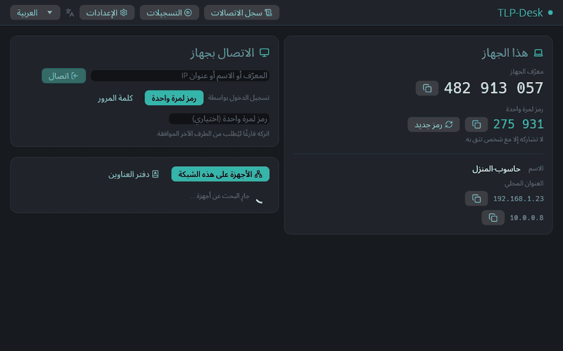
  </a>
  <br><sub><a href="docs/media/demo-ar.mp4">الفيديو بجودة كاملة (MP4)</a></sub>
</p>

- اكتشاف الأجهزة على الشبكة تلقائياً، أو الاتصال برقم الجهاز المكوّن من 9 خانات أو بعنوان IP.
- كل اتصال مشفّر، والسماح بالجلسة يتم بالضغط على «قبول» أو برمز لمرة واحدة.
- صورة سلسة بحدود 60 إطاراً في الثانية، وتحكم كامل بالماوس ولوحة المفاتيح (العربية والإنجليزية).
- صاحب الجهاز له الأولوية دائماً: لمس الماوس المحلي يوقف التحكم عن بُعد مؤقتاً.
- التنقل بين الشاشات إذا كان للجهاز الآخر أكثر من شاشة.
- مثبّت واحد `setup.exe` بالعربية والإنجليزية.

للتثبيت: نزّل ملف `TLP-Desk-<version>-setup.exe` من صفحة
[الإصدارات](https://github.com/Tamer-Mansour/TLP-Desk/releases) وشغّله على الجهازين.

الدليل الكامل بالعربية: [دليل المستخدم](docs/src/user-guide/ar/index.md).
قائمة الاختبار اليدوي على جهازين: [قائمة الاختبار](docs/src/user-guide/ar/manual-test.md).

</div>

---

## License

Dual-licensed under either of

- MIT license ([LICENSE-MIT](LICENSE-MIT))
- Apache License, Version 2.0 ([LICENSE-APACHE](LICENSE-APACHE))

at your option. Bundled fonts and icons keep their own licenses (SIL OFL, MIT, ISC); see the
license files shipped with the installer and [THIRD_PARTY_NOTICES.md](THIRD_PARTY_NOTICES.md).
