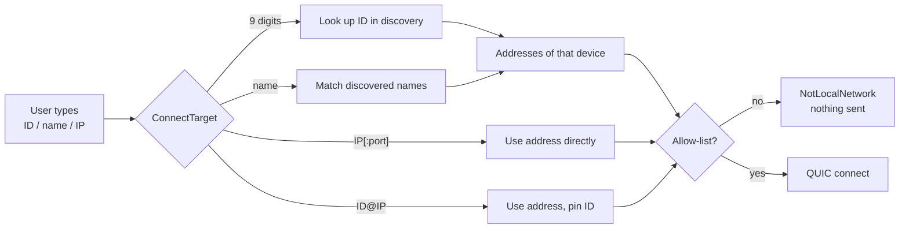
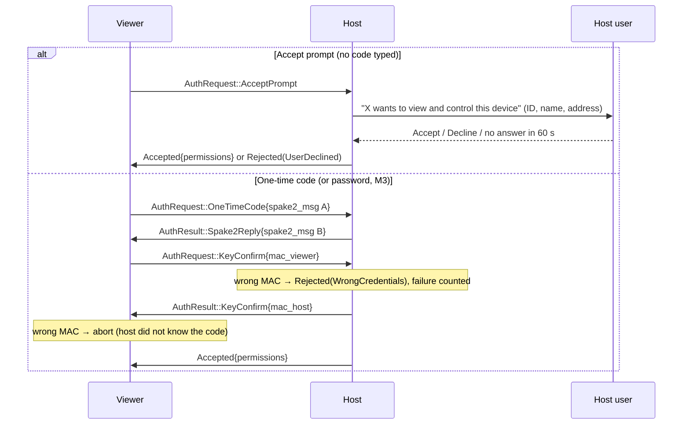

# Connection and authentication

How a viewer finds a host, makes sure it is talking to the right machine, and gets permission to
control it. The normative details are in the [wire protocol](../../protocol.md#authentication);
this page explains the flow.

## 1. Finding the host

Discovery merges mDNS (`_tlpdesk._udp.local.`) and the UDP 47401 broadcast fallback by device ID.
Name and ID lookups wait up to 4 s for discovery results.

## 2. TLS with pinning

Both sides present a self-signed certificate made from their long-term ECDSA P-256 key; the TLS
1.3 handshake proves each side owns its key. The viewer then decides whether this is the right
key:

| How the user dialed | Check | On failure |
|---|---|---|
| Device ID (or `ID@IP`) | SHA-256 of the host key must map to that ID | `PinMismatch` → "Identity check failed" |
| Address with a known fingerprint | Exact fingerprint match | "This device's identity has changed" warning |
| Address seen for the first time | Trust on first use; fingerprint stored | — |

The host checks the viewer's address against its allow-list *before* the TLS handshake and refuses
anything outside it.

## 3. Hello

The viewer sends `Hello { protocol_version, device_id, device_name, role }`; the host answers with
its own. A different protocol version → `Rejected(VersionMismatch)`. A `device_id` that does not
match the viewer's certificate → `Rejected(NotAllowed)`, so the ID the host user sees is always
authentic (the *name* is self-reported).

## 4. Authorization

- **SPAKE2** turns the 6-digit code into a shared key without sending the code. Both sides feed
  the TLS fingerprints and a TLS **exporter** value (channel binding) into the transcript, so a
  man-in-the-middle who terminates TLS separately with each side ends up with different
  transcripts and the key confirmation fails.
- **Key confirmation** is mutual: the host only sends its MAC after verifying the viewer's, and
  the viewer aborts if the host's MAC is wrong — a fake host cannot pretend the code was right.
- **Rate limits:** 5 code/password attempts per minute per IP, then a 10-minute lockout; the code
  also rotates after 3 failures and after every successful use. Accept prompts have their own
  per-IP limit (5 per minute) and a cap of 8 open prompts.
- **Password** (unattended access) uses the same SPAKE2 exchange keyed by an Argon2id verifier; it
  is wired in `net` but no front end sets a password yet (M3).

## 5. Session

After `Accepted { permissions }` the host starts streaming video and sends `MonitorList`. The
default permissions granted from the GUI are view + control + keyboard. The host can change them
live (`Permissions` message); removing `VIEW` ends the session.

## Failure messages

| Failure | What the viewer user sees |
|---|---|
| Address outside the allow-list | "Only addresses on the local network can be used." |
| ID/name not discovered | "Device not found on this network." |
| No answer from the address | "The device cannot be reached." |
| Pin mismatch, or host failed key confirmation | "Identity check failed. Connection stopped." |
| Known key changed (TOFU) | "Warning: this device's identity has changed" dialog |
| `UserDeclined` (incl. prompt timeout) | "The connection was declined." |
| `WrongCredentials` | "Wrong code or password." |
| `RateLimited` | "Too many attempts. Try again later." |
| `NotAllowed` | "This device does not accept connections from you." |
| `VersionMismatch` | "The other device runs an incompatible version." |

See also [Security](../../security.md),
[ADR 0002](../../adr/0002-spake2-with-channel-binding.md),
[ADR 0003](../../adr/0003-ecdsa-identity-and-device-id.md) and
[ADR 0004](../../adr/0004-tofu-and-fingerprint-pinning.md).
