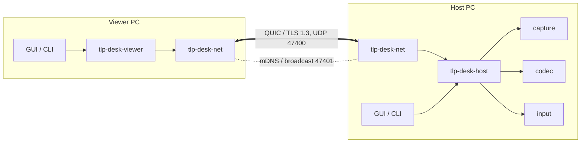

# Architecture overview

TLP-Desk is a single program that is always ready to be a **host** and can at any moment become a
**viewer**. There is no server: two PCs on the same LAN find each other, open one encrypted QUIC
connection and talk directly.

## Layers

| Layer | Crates | Knows about |
|---|---|---|
| Wire format | `proto` | Bytes and messages only |
| Security primitives | `crypto` | Keys, IDs, PAKE, rate limits — no I/O except the key file |
| Transport | `net` | QUIC, TLS pinning, the auth handshake, discovery |
| Platform | `capture`, `codec`, `input` (`audio`, `files` later) | One OS facility each, behind a trait |
| Session logic | `host`, `viewer` | Combine transport and platform; no GUI |
| Front ends | `app` (GUI), `cli` | Presentation, settings, i18n |

Each layer depends only on layers above it in this table. Session logic is tested end to end with
fake platform implementations (the host's `CapturerFactory`, `EncoderFactory`, ... aliases), so
most of the system runs in CI without a desktop.

## One connection, several streams

A session is one QUIC connection:

- a **control stream** (bidirectional, opened by the viewer, high priority) carries the handshake
  and every message except video — input, monitor changes, permission updates, `Bye`;
- **one unidirectional stream per video frame**, opened by the host, low priority.

Because frames are independent streams, a late frame never blocks a newer one, and the host can
simply not send a frame when the viewer is behind. See
[ADR 0001](../../adr/0001-quic-stream-per-video-frame.md).

## Threads at a glance

| Where | Thread / task | Job |
|---|---|---|
| Host, per session | `tlp-host-video-<id>` | capture loop |
| | `tlp-host-video-<id>-encode` | encode loop |
| | `tlp-host-input-<id>` | inject input, local-priority gate, pointer marker control |
| | tokio task | control stream loop |
| Host, once | `tlp-desk-local-activity`, `tlp-desk-pointer-marker` | Windows hooks / marker window |
| Viewer, per session | `tlp-viewer-decode` | H.264 decode + pixel conversion |
| | tokio tasks | video receive, control, input send, stats |
| GUI | UI thread + 2 tokio workers (`tlp-desk-backend`) | egui; all networking |
| GUI, in a session | `tlp-desk-keyboard-grab`, `tlp-desk-grab-forward` | system-key hook and forwarding |

Blocking OS work (capture, encode, decode, hooks) stays on dedicated threads; the async runtime
only moves bytes.

## Where to go next

- [Video pipeline](video.md) — capture → encode → QUIC → decode → texture.
- [Input path](input.md) — viewer mouse/keyboard → host `SendInput`, and local priority.
- [Connection and authentication](auth.md) — discovery, TLS pinning, SPAKE2.
- [Crates](../crates/index.md) — one page per crate.
- [Wire protocol](../../protocol.md) — the normative spec.
