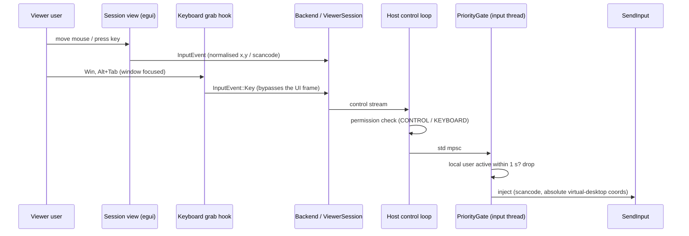

# Input path

How a mouse movement or key press on the viewer becomes input on the host — and how the person at
the host stays in control.

## Viewer side

1. **Pointer.** The video is letterboxed into the window (`ViewRect::fit`). A pointer position is
   converted to `0..=65535` over the *image*, not the window, and clamped to its edges. Movement
   outside the image is only sent while a button is held (dragging). Units only need to be
   consistent, so the viewer's own DPI does not matter.
2. **Wheel.** Converted to Windows `WHEEL_DELTA` units (120 per notch).
3. **Keys.** The *physical* key is translated to a set-1 scancode (`input_map.rs`). The host's
   layout picks the character, so Arabic and English layouts need no translation.
4. **System keys.** While the session view is focused and keyboard input is allowed, a low-level
   keyboard hook swallows Win, Alt+Tab, Alt+Esc, Ctrl+Esc, Alt+F4, PrintScreen and similar, and
   forwards them straight to the backend. Ctrl+Alt+Del and Win+L cannot be intercepted.
5. **Release.** Losing focus, opening a modal, enabling view-only or switching monitors sends
   `ReleaseAll`, so no key or button stays stuck on the host.

## Host side

1. **Permission gate** (control loop): mouse events require `CONTROL`, keys `KEYBOARD`,
   `ReleaseAll` either. A view-only session sends nothing in the first place.
2. **Input thread** (`tlp-host-input-<id>`): owns the injector and ticks every 40 ms.
3. **Local priority** (`PriorityGate`): low-level mouse and keyboard hooks record the time of the
   last *physical* local event (injected events, including our own `SendInput`, are ignored).
   While that is younger than the grace window (1000 ms by default), every remote event except
   `ReleaseAll` is dropped, and on entering this state everything the viewer held is released.
   Each change is sent to the viewer as `HostInputPriority`, which shows a notice.
4. **Mapping.** The normalised position is mapped to a pixel of the **streamed monitor** (even if
   the video was downscaled), then to a `MOUSEEVENTF_VIRTUALDESK` absolute value that Windows
   maps back to exactly that pixel, across multiple monitors and mixed DPI.
5. **Injection.** `SendInput` with `KEYEVENTF_SCANCODE` for keys. If Windows inserts fewer events
   than requested (an elevated window or the secure desktop refused them), the injector reports
   `Blocked`; making that work is part of M3 (service on the secure desktop).
6. **Pointer marker.** While the viewer moves the pointer and the local user is idle, a green
   marker labelled with the viewer's name follows the pointer on the host screen; it hides 1.5 s
   after the last remote move. It is excluded from capture, so the viewer never sees it.

See [ADR 0010](../../adr/0010-local-input-priority.md) and
[ADR 0011](../../adr/0011-capture-exclusion-for-pointer-marker.md).
