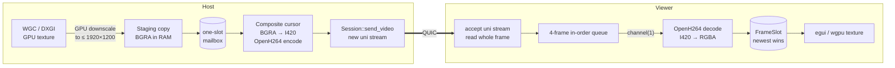

# Video pipeline

From pixels on the host's monitor to a texture in the viewer's window.

## Stage by stage

| Stage | Where | Key facts |
|---|---|---|
| Capture | `capture` | Windows.Graphics.Capture, DXGI fallback. D3D device on the adapter that drives the monitor. Pointer excluded from the image. |
| Downscale | `capture::GpuScaler` | Monitors larger than 1920×1200 are scaled on the GPU (mips + bilinear) before readback: 9 MB instead of 36 MB per 4K frame. |
| Hand-off | `host::pipeline` | A one-slot mailbox: a new frame *replaces* an unencoded one. |
| Pacing | `host::pipeline` | Encode only when something changed and the next `1/fps` slot (60 fps default) has come. Static screen → no frames. |
| Cursor | `host::cursor` | Composited into the BGRA frame, scaled to the frame; only the patch underneath is saved and restored. |
| Encode | `codec::H264Encoder` | Constrained baseline, no B-frames, IDR only on request, ~0.1 bit/pixel, no internal frame skipping. |
| Send | `net::Session::send_video` | One unidirectional QUIC stream per frame. Non-key frames dropped at ≥ 3 in flight, keyframes at ≥ 6. A drop requests a keyframe. |
| Receive | `net` | Each stream read concurrently; frames delivered in `seq` order through a 4-frame queue; stale frames discarded; after a gap, skip to the next keyframe and send `RequestKeyframe` (≤ every 250 ms). |
| Decode | `viewer` decode thread | Capacity-1 job channel; decode error → request keyframe and skip to it. Output RGBA for the GUI. |
| Display | `app` | `FrameSlot` keeps only the newest frame; the UI uploads it as a texture on its next repaint. |

## Where latency can hide — and why it doesn't

Every buffer in the pipeline holds **at most one or a few frames**, and every full buffer drops
the *oldest* data:

1. Capture → encode: one slot, replaced.
2. Encode → network: at most 3 frames in flight, then drop.
3. Network → decoder: 4-frame queue, then drop + keyframe request.
4. Decoder → screen: one slot, replaced.

So when anything is slower than the source, the viewer sees fewer frames per second, never older
frames. See [Performance notes](../performance.md).

## Keyframes

A keyframe (IDR) is produced:

- for the first frame of every encoder (session start, resolution change, monitor switch, capture
  reopen after the lock screen or a display mode change);
- after the host dropped a frame because the viewer was behind;
- when the viewer asks (`RequestKeyframe`) after a lost or undecodable frame.

There is no periodic keyframe (`uiIntraPeriod = 0`): on a LAN, recovering on demand is cheaper
than sending a full frame every few seconds.

## Timestamps and the latency figure

The host stamps each frame with the time of the oldest screen change it contains (microseconds
since session start). The viewer cannot compare clocks directly, so the stats overlay shows an
estimate: `RTT/2 + queue delay + decode time`, where queue delay is how much later than the best
case this frame arrived. Display time is not included. See
[tlp-desk-viewer](../crates/viewer.md#stats).
