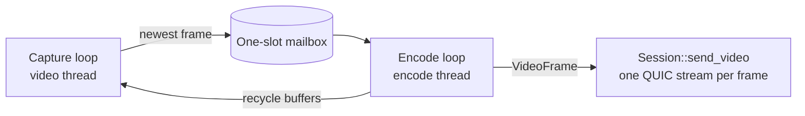

# tlp-desk-host

**The host side of a session**: accept or authenticate incoming viewers, stream the screen, inject
their input, keep the local user in charge, and report everything to the UI as events. It has no
GUI dependency — the GUI and the CLI both drive the same `Host`.

| | |
|---|---|
| Path | `crates/tlp-desk-host` |
| Depends on | `proto`, `crypto`, `net`, `capture`, `codec`, `input`, `tokio`, `tracing` |
| Used by | `app`, `cli` |
| Unsafe | `#![forbid(unsafe_code)]` |
| Threads | tokio tasks for the accept loop and each session's control loop; per session one input thread and one video thread (which spawns an encode thread) |

## Public API

- `Host::start(identity, HostConfig).await` — binds (or reuses) the endpoint, starts discovery
  advertising and the accept loop. Every other method is non-blocking.
- Codes and secrets: `one_time_code()` (`display()` → `042 917`), `rotate_code()`,
  `set_password(Option<PasswordVerifier>)`.
- Requests: `pending_requests()`, `accept(id, Option<Permissions>)` (`None` = the configured
  default), `reject(id)`.
- Sessions: `sessions()` (the security banner must always reflect this), `set_permissions(id,
  permissions)` (removing `VIEW` ends the session), `disconnect(id)`, `disconnect_all()`.
- `device_id()`, `fingerprint()`, `endpoint()`, `discovery()`, `shutdown()` (also on drop).
- Events arrive on an unbounded channel (`HostEvents`):
  `IncomingRequest`, `RequestCancelled { reason }` (`ViewerLeft`, `TimedOut`, `HostShutdown`),
  `AuthFailed`, `CodeChanged`, `SessionStarted(ConnectedViewer)`, `PermissionsChanged`,
  `SessionEnded { reason }` (`Local`, `Remote(ByeReason)`, `PermissionRevoked`,
  `ConnectionLost`, `Error`), `Feature { id, event }`.
- Factories (`CapturerFactory`, `EncoderFactory`, `InjectorFactory`, `LocalActivityFactory`,
  `PointerMarkerFactory`, `MonitorLister`) let tests replace real hardware with fakes.

### `HostConfig` defaults

| Field | Default |
|---|---|
| `monitor` | 0 (primary) |
| `fps` | 60 |
| `accept_timeout` | 60 s (an unanswered Accept prompt is declined) |
| `prompt_rate_limit` | 5 prompts per minute per IP, then a 10-minute lockout; accepting clears it |
| `max_pending_prompts` | 8 |
| `allow_one_time_code` | `true` |
| `password` | `None` (password access disabled) |
| `default_permissions` | `VIEW | CONTROL | KEYBOARD` (`DEFAULT_PERMISSIONS`) |
| `advertise` | `true` |
| `local_input_grace` | 1000 ms (0 disables local priority) |
| `remote_pointer_marker` | `true` |
| `features` | empty `FeatureSet` — the app or CLI registers session features here |

### Session features

Feature lanes (files, clipboard, chat, audio, ...) do not edit this crate. For each session the
host starts a `FeatureDispatch` from `HostConfig::features`; control messages the core does not
handle are passed to the feature that claims them **after** the session's permissions are checked
against `Message::required_permissions()` (blocked messages are dropped). Permission changes are
forwarded to the features, and features report to the UI through
`HostEvent::Feature { id, event }`. See [tlp-desk-net, Features](net.md#features-featurers).

`MAX_CAPTURE_SIZE = (1920, 1200)`; `open_default_capturer(monitor)` opens WGC with DXGI fallback
capped at that size.

## Authorization

- **Accept prompt:** per-IP rate limit, then a cap of 8 open prompts (both answer
  `RateLimited`), then an `IncomingRequest` event. The prompt resolves on the user's decision, the
  viewer leaving, or the 60 s deadline (declined → `UserDeclined`).
- **One-time code / password:** delegated to `PendingSession::verify_code` /
  `verify_password` in [`tlp-desk-net`](net.md). If the method is disabled the viewer gets
  `NotAllowed`. Wrong secrets map to `WrongCredentials`, lockouts to `RateLimited`.
- **Per-message gating:** mouse events need `CONTROL`, keys need `KEYBOARD`, `ReleaseAll` needs
  either. Losing `CONTROL`/`KEYBOARD` mid-session releases everything; losing `VIEW` closes the
  session with `PermissionRevoked`.

## Video pipeline (`pipeline.rs`)



- **One-slot mailbox.** `put_frame` *replaces* any frame still waiting, so a slow encoder drops
  frames instead of queueing them (`slow_encoder_drops_frames_instead_of_queueing` checks that
  with an 80 ms-per-frame encoder).
- **Pacing.** The encode loop waits until something changed (a new frame, a cursor change or a
  keyframe request) *and* the next frame slot (`1 / fps`) has arrived. A static screen sends
  nothing.
- **Timestamps.** The wire `timestamp_us` is the time of the oldest change in that frame, which
  the viewer uses for its latency estimate.
- **Backpressure.** If `send_video` returns `Dropped` (viewer behind), a keyframe is requested and
  kept pending so it is sent even if the screen then stays still.
- **Encoder lifecycle.** Created with `EncoderConfig::for_screen(w, h, fps)` from the capturer's
  `frame_size()`; recreated on a size change or `SizeMismatch`; every new encoder starts with a
  keyframe.
- **Capture resilience.** Initial open: up to 10 attempts, 500 ms apart. `SurfaceLost` (lock
  screen, UAC, display mode change) → reopen with unlimited retries. Other errors are tolerated up
  to 100 in a row with 20 ms pauses. Each reopen bumps a *generation* so the encoder emits a
  keyframe.
- **Cursor.** The capturer excludes the pointer and the protocol has no cursor message, so the host
  composites the cursor (scaled to the frame) into the image before encoding, saving and restoring
  only the patch underneath. A cursor-only movement triggers an encode.

See [Performance notes](../performance.md) for the reasoning.

## Monitors

The monitor list is polled every 2 s (`MONITOR_POLL`). `MonitorList { monitors, active }` is sent
after `Accepted` and whenever the list or the active monitor changes. `SelectMonitor { index }`
with an unknown index is ignored; a known one reopens capture on that monitor (one attempt — on
failure the current monitor stays), re-maps input to the new rectangle and forces a keyframe.

## Input and local priority (`input.rs`, `priority.rs`)

A per-session input thread (`tlp-host-input-<id>`, 40 ms tick) owns the injector.

- The local-activity monitor and the pointer marker are started lazily, on the first remote event
  and the first remote `MouseMove` respectively.
- `PriorityGate`: local priority is active while the last physical local input is younger than
  `local_input_grace`. On entering it, everything the viewer holds is released; while it lasts,
  every remote event except `ReleaseAll` is dropped. Each change is reported to the viewer as
  `HostInputPriority { local_active }`.
- The marker is labelled with the viewer's name (or ID if the name is empty) and is visible while
  the viewer moved the pointer within the last 1.5 s (`MARKER_HOLD`) and the local user is idle.

## The Windows service (`service/`)

The service (`TLP-Desk.exe --service`, SYSTEM, session 0) owns UDP 47400 and the `Host`; a
**session agent** (`--agent`, SYSTEM token in the console session) does everything that needs the
user's desktop. They talk over SYSTEM-only named pipes with the local IPC in `service/ipc.rs`
(`IPC_VERSION` 2; both ends are the same binary).

| Channel | Direction | What |
|---|---|---|
| `Capture`, `Input`, `Command`, `Events` | service -> agent | screen, input, monitors/lock, desktop switches (v1) |
| `Feature` | service -> agent, request/reply | clipboard, Explorer virtual files, whiteboard overlay, pointer marker, local-input hooks, privacy shield (v2) |
| `Audio` | agent -> service | loopback sound, with keep-alives (v2) |

* Agent side: `FeatureHost` (`agent_features.rs`) drives the objects created by the app's
  `AgentFeatures` (`tlp-desk-app/src/service_host/agent.rs`); their signals (clipboard changed,
  local input, shield off, overlay clear, paste begin/cancel) go out on the events channel.
* Service side: `AgentFeatureHub` (`feature_proxy.rs`) hands the host and the session features
  proxies (`LocalActivity`, `PointerMarker`, `WhiteboardOverlay`, `PrivacyShield`, plus clipboard,
  shell offer and audio calls). Updates that must not block go through one worker thread; after
  an agent restart overlays and markers re-create themselves, the hooks restart and an engaged
  shield reports `Failed` (privacy mode turns off).
* The app plugs in with `ServiceExtension` (`extension.rs`): endpoint/host configuration, every
  host event, the console user's folders (`windows::console_user`, resolved with the user's
  token), and opaque app messages on the GUI pipe (`GuiEvent::App`, `GuiCommand::App`). The app's
  `service_host` defines those messages (transfers, upload questions, chat, privacy, settings)
  and the GUI's `ServiceMirror` turns them into the usual `BackendEvent`s.
* Because the service writes as SYSTEM, file transfers are limited to the console user's profile
  (`FileTransfer::set_allowed_roots`, links resolved) and uploads go to their Desktop.
* Tests: `agent_features/tests.rs` and `feature_proxy/tests.rs` run the agent's `FeatureHost`
  with fake OS objects (`testutil/features.rs`) over in-memory pipes, end to end through
  `AgentLink`.

## Tests

- Unit: `input_gating_follows_permissions`; priority (`remote_events_blocked_during_grace`,
  `takeover_releases_remote_held_state_once`, `remote_resumes_after_grace`,
  `injected_events_do_not_count_as_local_input`, `zero_grace_disables_priority`,
  `marker_follows_remote_pointer_and_hides_for_local`, ...); input thread
  (`marker_not_created_without_remote_pointer_moves`,
  `marker_hides_after_remote_pointer_goes_idle`, `local_takeover_and_resume_on_input_thread`);
  cursor compositing.
- `tests/e2e.rs` — a real host and viewer over loopback QUIC with a fake capturer:
  `accept_prompt_streams_video_and_injects_input`, `view_only_permissions_block_input`,
  `reject_reaches_viewer`, `unanswered_prompt_times_out_and_rejects`,
  `accept_prompts_are_rate_limited_per_ip`, `one_time_code_flow`,
  `host_disconnect_ends_viewer_session`, `tofu_remembers_key_and_detects_change`,
  `wrong_device_id_is_rejected`, `public_addresses_are_refused`, `viewer_switches_monitor_live`,
  `local_input_priority_reaches_viewer`, `slow_encoder_drops_frames_instead_of_queueing`,
  `scaled_video_maps_clicks_to_physical_monitor_pixels`.
- `tests/hostile_viewer.rs` — an authorized viewer that misbehaves, on
  [`tlp-desk-testkit`](testkit.md) with a probe feature: every gated feature message is blocked
  without its permission and passes only while it is granted live; input needs `CONTROL` /
  `KEYBOARD`; host-only messages from the viewer (a forged `Permissions(ALL)`, `Accepted`,
  `Hello`, video on the control stream, ...) grant nothing; unknown monitor indices are ignored;
  floods and a 14 MiB payload do not end the session; revoking `VIEW` and a reconnect loop leave
  no session, thread or feature task behind and release held keys.
- **Ignored:** `real_capture_end_to_end` — needs a real interactive desktop;
  `tests/soak.rs` `soak_host_and_viewer_stay_bounded` — runs for `TLP_SOAK_SECS` (default 600).

```powershell
cargo test -p tlp-desk-host
cargo test -p tlp-desk-host --test e2e -- --ignored real_capture_end_to_end
$env:TLP_SOAK_SECS = "600"; cargo test --release -p tlp-desk-host --test soak -- --ignored --nocapture
```
