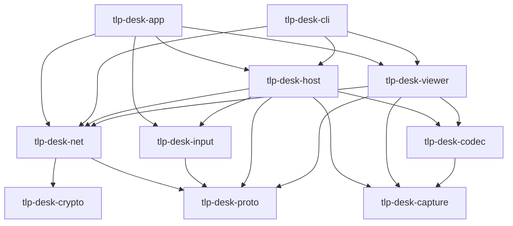

# Crates

TLP-Desk is one Cargo workspace (`crates/*`, edition 2021, `rust-version = "1.85"`). Each crate
owns one concern; platform code sits behind traits so other operating systems can be added
later without touching session logic.

| Crate | Role | Status |
|---|---|---|
| [`tlp-desk-proto`](proto.md) | Wire messages, `PROTOCOL_VERSION`, framing, stream headers | Done for v4 |
| [`tlp-desk-crypto`](crypto.md) | Identity key, device ID, known hosts, SPAKE2, password verifier, rate limiter | Done for M1 |
| [`tlp-desk-net`](net.md) | QUIC endpoint and session, TLS pinning, allow-list, discovery, Wake-on-LAN | Done for M1 |
| [`tlp-desk-capture`](capture.md) | `ScreenCapturer` trait; Windows.Graphics.Capture and DXGI; GPU downscale | Done for M1 |
| [`tlp-desk-codec`](codec.md) | `VideoEncoder` / `VideoDecoder` traits; H.264 via OpenH264; colour conversion | Done for M1 |
| [`tlp-desk-input`](input.md) | `InputInjector` trait, `SendInput`, coordinate mapping, keyboard grab, local activity, pointer marker | Done for M1 |
| [`tlp-desk-audio`](audio.md) | System audio loopback + Opus, jitter buffer, session features | Done for M2 |
| [`tlp-desk-files`](files.md) | File transfer + clipboard sync | Placeholder |
| [`tlp-desk-host`](host.md) | Host session: capture → encode → send pipeline, input, priority, monitors | Done for M1 |
| [`tlp-desk-viewer`](viewer.md) | Viewer session: receive → decode → frames, input out, stats | Done for M1 |
| [`tlp-desk-app`](app.md) | The GUI binary `TLP-Desk.exe` (egui/eframe + wgpu), i18n, settings | Done for M1 |
| [`tlp-desk-cli`](cli.md) | The headless binary `TLP-Desk-cli.exe` (`id`, `list`, `serve`, `connect`) | M1 done; `send-file`, `exec-wol` planned |
| [`tlp-desk-relay`](relay.md) | The self-hosted relay server `tlp-desk-relay` (Linux): UDP forwarder with an HMAC-authenticated control protocol | Done (ADR 0013) |
| [`tlp-desk-testkit`](testkit.md) | Dev-only: fakes and a host + viewer pair harness for tests (`publish = false`) | Available |

## Dependency graph

`tlp-desk-codec` depends on `tlp-desk-capture` only for the shared `BgraFrame` type. The
`files` crate has no dependencies yet.

## Common rules

- **Errors:** `thiserror` enums in libraries; `anyhow` only in the two binaries.
- **Unsafe:** pure crates use `#![forbid(unsafe_code)]`. Crates that wrap Windows APIs
  (`capture`, `codec`, `input`) use `#![deny(unsafe_code)]` at the root and
  `#[allow(unsafe_code)]` on exactly one platform module; every `unsafe` block there carries a
  `// SAFETY:` comment. See [coding conventions](../conventions.md).
- **Touch only your crate** unless the task says otherwise; protocol changes need a
  `PROTOCOL_VERSION` bump and a `docs/protocol.md` update.
