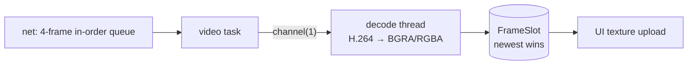

# tlp-desk-viewer

**The viewer side of a session**: resolve what the user typed to an address, connect with the
right pin, decode video into a "latest frame" slot, send input, and report stats.

| | |
|---|---|
| Path | `crates/tlp-desk-viewer` |
| Depends on | `proto`, `crypto`, `net`, `capture`, `codec`, `tokio`, `tracing` |
| Used by | `app`, `cli` |
| Unsafe | `#![forbid(unsafe_code)]` |
| Threads | one decode thread (`tlp-viewer-decode`) plus tokio tasks for video, control, input and stats |

## Connecting

`ConnectTarget` parses what the user typed (`FromStr`):

| Input | Target | Pin |
|---|---|---|
| `123 456 789` | `Id` — resolved through discovery | the key must hash to that ID |
| `192.168.1.20`, `192.168.1.20:47400`, `[fe80::1]:47400` | `Addr` | stored fingerprint, else trust on first use |
| `123456789@192.168.1.20[:port]` | `IdAt` | the key must hash to that ID |
| anything else | `Name` — matched against discovered device names, case-insensitive | as for the resolved device |

`Viewer::new(identity, ViewerConfig)`; `set_discovery(discovery)`; `connect(target, auth)` or
`connect_with_progress(target, auth, on_awaiting_accept)`.

- `ViewerConfig` defaults: BGRA output, `resolve_timeout` 4 s (discovery is polled every
  200 ms), `AllowList::default()`.
- The allow-list is checked **before any packet is sent**: a public address fails with
  `NotLocalNetwork` without contacting it.
- Each resolved address is tried in turn; only transport errors (unreachable, not allowed) fall
  through to the next one.
- On success the host's fingerprint is remembered under both its address key and its ID in
  `known_hosts`. Later connections pin to it. A different key fails with `HostKeyChanged` until
  `Viewer::forget(key)` is called — that is what the app's "Forget old key and connect" button
  does.

`ViewerError` covers: not found on the network, not a local-network address, unreachable,
rejected (with `RejectReason`), identity mismatch ("the device at this address is X, not Y"),
host key changed (previous and presented fingerprints), host failed to prove the code/password,
protocol version mismatch, known-hosts store errors. Note that a network timeout is reported as
`Unreachable("timed out")`.

## Session

`ViewerSession` methods: `peer`, `permissions`, `frames` / `take_frame`, `stats`, `rtt`,
`send_input`, `monitors`, `select_monitor`, `host_input_priority`, `disconnect`, `end_reason`,
`ended().await`. Dropping it disconnects.

Events (`ViewerEvent`): `PermissionsChanged`, `Stats(ViewerStats)`, `HostInputPriority(bool)`,
`MonitorsChanged { monitors, active }`, `Ended(EndReason)`.

### Frame path



- The job channel to the decoder has capacity 1: if decoding falls behind, the network layer's
  small queue overflows, drops frames and requests a keyframe — latency never builds up.
- `FrameSlot` keeps only the newest decoded frame and recycles the previous buffer.
- Pixel format conversion (BGRA → RGBA for the GUI) happens on the decode thread.
- A decode error requests a keyframe and skips frames until one arrives.

### Stats

Computed once per second: `fps`, `bitrate_kbps`, `rtt_ms` (QUIC smoothed RTT), `decode_ms`,
`latency_ms`, `frames_received`, `frames_decoded`, `width`, `height`.

The latency figure is an **estimate** because the two clocks are not synchronised:

```text
latency ≈ RTT/2 + queue_delay + decode_time
queue_delay = (arrival − host_timestamp) − min(arrival − host_timestamp) seen so far
```

It excludes display time, so it is a lower bound on glass-to-glass latency.

## Tests

`target_parsing`, `addr_keys_omit_default_port`, `slot_keeps_only_newest`,
`convert_swizzles_and_drops_stride_padding`. The full connect/stream/input path is exercised by
the host's `tests/e2e.rs` and the app's `tests/real_backend.rs`.

```powershell
cargo test -p tlp-desk-viewer
```
